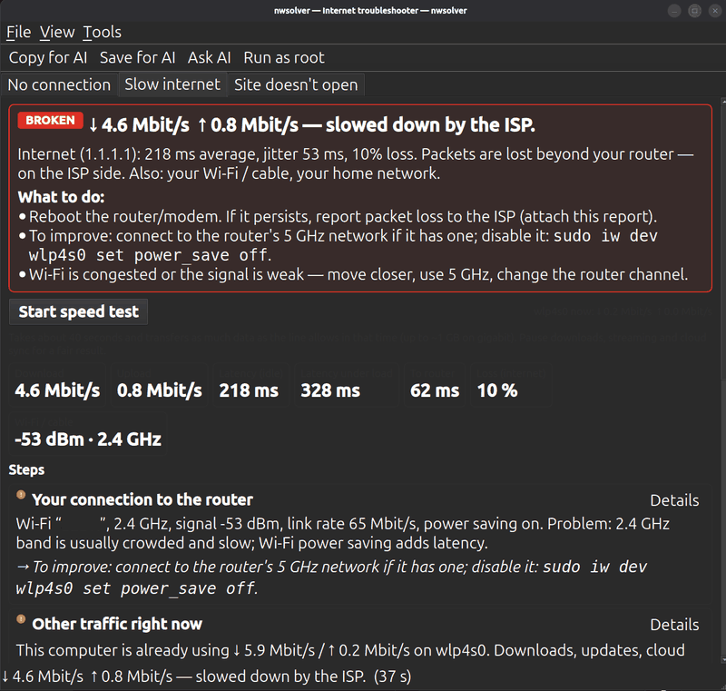
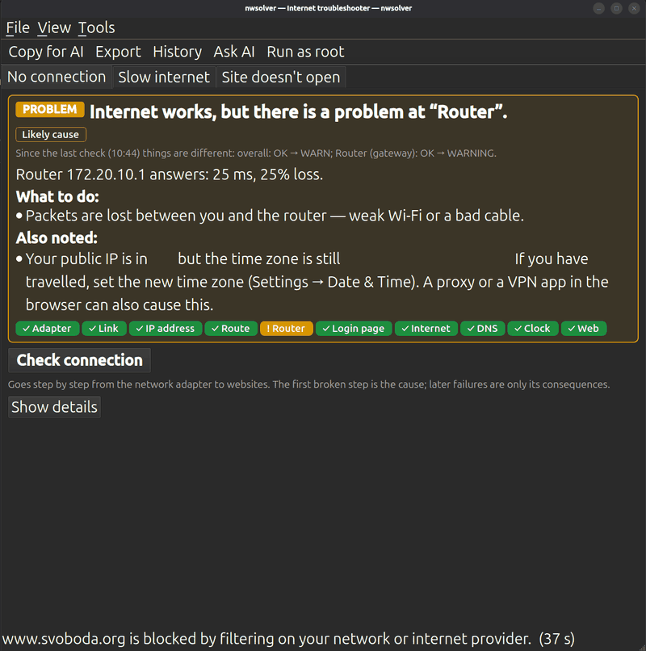
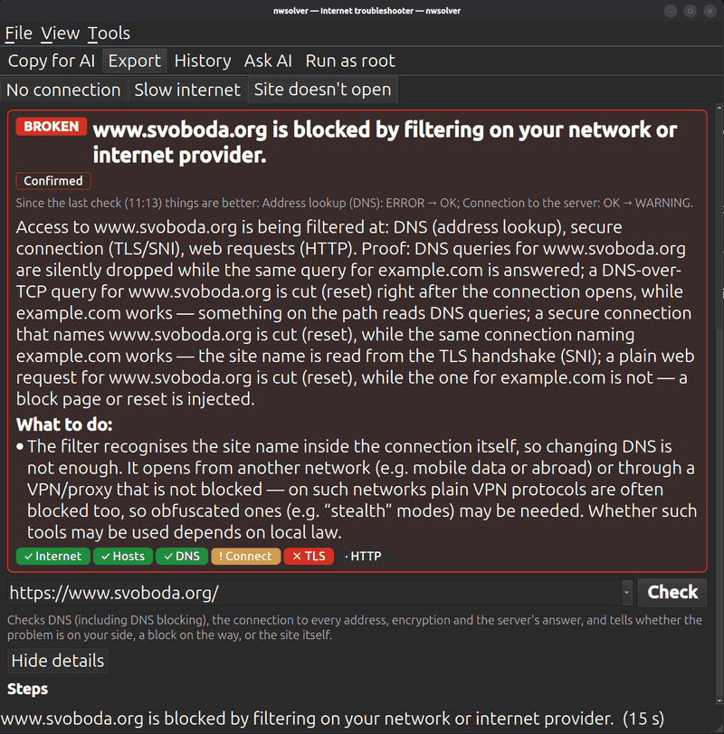

# nwsolver — find out why your internet isn't working

nwsolver is a small app for Ubuntu that checks your connection and tells
you, in plain words, **what is wrong and what to do about it**. It is made
for everyday use at home and for travellers on hotel, café, airport and
phone-hotspot Wi-Fi.



## What it helps with

The app has three tabs, one for each kind of problem:

| Tab | Use it when… | What you get |
|---|---|---|
| **No connection** | websites don't open at all | Where the connection breaks — your Wi-Fi or cable, the router, a hotel login page, the internet provider, a VPN, the clock — and how to fix it |
| **Slow internet** | pages load slowly, video stutters, calls freeze | Your real speed, what slows it down, and whether the connection is good enough for video calls |
| **Site doesn't open** | everything works except one site or app | Whether the problem is on your computer, the site is blocked on the way, or the site itself is down |

It recognises the situations travellers run into most:

- **Hotel or café Wi-Fi asks you to sign in**, but the login page never
  appears. nwsolver finds it and opens it with one button: *Open login
  page*.
- **A VPN was left on** and now nothing works on the new network.
- **Wrong time after changing time zones**, so secure sites show
  certificate errors.
- **Connected through your phone** (hotspot or USB) and the phone's mobile
  data or roaming is off.
- **Some services are blocked** in the country or on the network. For a
  site that doesn't open, the app tells apart a site that is down, a block
  in your own DNS, and filtering by the network or internet provider. In
  the last case it shows how it is done (blocked address lookups, cut
  secure connections, injected block pages, blocked addresses) and what
  can still work.
- **The network blocks video calls or VPNs** (UDP traffic).
- **Open Wi-Fi without a password**: you get a reminder to stay on secure
  sites.

## Install

1. Download the file `nwsolver_0.4.0_amd64.deb`.
2. Double-click it and choose **Install** (in *Software* / *App Center*).
   You can also open a terminal in the download folder and run:

   ```sh
   sudo apt install ./nwsolver_0.4.0_amd64.deb
   ```

3. Open **nwsolver** from the applications menu.

Works on Ubuntu 22.04 and newer (and similar systems such as Linux Mint,
Pop!_OS, Debian 12+). No administrator password is needed to use it.

## How to use it

1. **Open the app.** It checks your connection straight away.
2. **Read the box at the top.** It shows:
   - the result, as a coloured label: **OK**, **PROBLEM** or **BROKEN**;
   - a one-sentence explanation of what is wrong;
   - how sure the app is: *Confirmed* (it measured the fault),
     *Likely cause* (the most probable explanation) or *Not enough data*;
   - **What to do**: the steps to fix it, in order;
   - **Also noted**: other things worth knowing, for example "this Wi-Fi
     has no password".
3. **Follow the steps, then press the check button again.** After a new
   check the app tells you what has changed, for example *"Since the last
   check things are better: Login page ERROR → OK"*.

Want to know more? Press **Show details** to see every step that was
checked. **Details** next to a step shows exactly what was measured.



### Slow internet

Press **Start speed test**. It takes about 40 seconds. Pause downloads,
streaming and cloud sync first for a fair result. You get download and
upload speed, delay, the quality of your Wi-Fi, and a verdict for video
calls (*Good*, *OK with limits* or *Poor*), plus what is holding the
speed back.

### A site doesn't open

Type the address (for example `example.com`) and press **Check**. The app
follows it step by step and tells you whose problem it is.



## Getting help from an AI assistant

If you want a second opinion, nwsolver prepares the question for you:

- **Copy for AI** copies a ready-made request with the problem, your
  setup and the results. Paste it into ChatGPT, Claude, Gemini or another
  AI chat and you get step-by-step advice.
- **Export…** lets you preview the text first, choose what to hide, and
  save it as a file. You can also save it as a detailed report to send to
  your internet provider or IT department.

By default the export hides your public IP address, device (MAC)
addresses, Wi-Fi name and computer name. Passwords and keys are never
included.

## History

Every check is saved on your computer. Open **History** to see earlier
results and compare: handy when the problem comes and goes, or when you
want to show the provider that the connection dropped yesterday too.

## Privacy

- Everything runs on your computer. The app only contacts well-known
  public test servers (for example Cloudflare and Google) to check the
  connection and measure speed.
- Nothing is sent anywhere unless you copy or export it yourself.
- The app never changes your settings. It tells you what to change, and
  you decide.

## Questions

**Do I need to run it as administrator?** No. *Run as root* only adds a
few extra details; everything important works without it.

**How much data does the speed test use?** As much as your connection can
download and upload in about 15 seconds: around 100 MB on an average
connection, up to 1–2 GB on very fast ones. On a mobile hotspot, check
your data allowance first.

**The text is too small or too big.** Use **View → Larger text / Smaller
text** (Ctrl + and Ctrl −). The app remembers your choice, and the size
and position of the window.

**Can I ask the built-in AI directly?** Yes, if you have an account with an
AI provider: set it up in **Tools → AI assistant settings…**, then use
**Ask AI**.

---

## For developers

- Run from source: `python3 -m venv .venv && .venv/bin/pip install -r
  requirements.txt && ./start.sh`
- Terminal mode: `./start.sh --selftest`, `--selftest --speed`,
  `--selftest --check example.com`
- Build the package: `sh packaging/build_deb.sh` → `dist/nwsolver_<version>_amd64.deb`
  (PySide6 is downloaded once and cached in `dist/cache/`).
- Design and the list of all checks: [docs/PLAN.md](docs/PLAN.md).
- The diagnostic engine uses only the Python standard library; the window
  uses PySide6 (Qt). Licence of the bundled Qt: LGPL.
